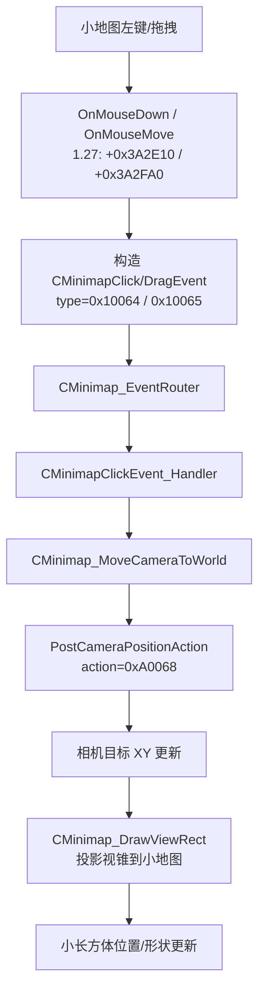

# Warcraft III：小地图视口小长方体（相机框）移动逻辑

## 结论摘要

点击小地图后，**小长方体跟着移动**，不是 UI 直接改矩形坐标，而是：

1. `CMinimap` 把点击坐标仿射变换成世界 XY，发出 `CMinimapClickEvent`（类型 id `0x10064`）
2. 事件路由到 **ClickHandler**，取出事件里的世界 XY
3. 调用汇合点 **`CMinimap_MoveCameraToWorld`**（移动相机目标的中枢函数）
4. 再调用 **`PostCameraPositionAction`**，投递动作类型 **`0xA0068`** 的相机位置包
5. 相机目标更新后，每帧 **`CMinimap_DrawViewRect`** 按当前相机投影重画小长方体

因此：若问「移动那个小长方体位置的函数」，工程上应盯 **`CMinimap_MoveCameraToWorld`**；若问「点小地图时谁触发移动」，盯 **`CMinimapClickEvent_Handler`**；若问「谁画这个框」，盯 **`CMinimap_DrawViewRect`**。

| 项目 | 记录 |
| --- | --- |
| 主分析版本 | 1.27.0.52240（Ghidra `War3_127`） |
| 实机校验版本 | 1.26.0.6401（与 iCCup `Game.dll` SHA-256 一致） |
| 目标文件 | `game.dll` |
| 1.27 大小 / SHA-256 | 13,187,048 / `E04D1716603C075EB0C8E1E21CF1093A664ADC5249EFAB396BFA08D7B09D0C3A` |
| 1.26 大小 / SHA-256 | 12,042,240 / `6D21BD9A0F9FBC84...`（完整见 `artifacts/minimap-viewport/version-offsets.json`） |
| 工具 | Ghidra 12.1.4 headless、Capstone、PE/RTTI 扫描；REA CLI 可用但本次 Ghidra provider 需 `GHIDRA_INSTALL_DIR` |
| Ghidra 项目 | `War3Analysis/ghidra/projects/War3_127.gpr` |
| ImageBase | `0x6F000000` |
| 置信度 | 静态调用链（1.27/1.26）：**高**；实机字节比对（1.26）：**高**；x32dbg 断点点击逐步验证：**未做**（已给出 BP 点） |

## 调用链（点击 → 相机动 → 框跟着动）



### 1.27.0.52240 关键 RVA

| 符号（本文命名） | RVA | VA | 作用 |
| --- | ---: | ---: | --- |
| `CMinimap_OnMouseDown_Click` | `0x3A2E10` | `0x6F3A2E10` | 点击：UI→世界坐标，发 `0x10064` |
| `CMinimap_OnMouseDrag` | `0x3A2FA0` | `0x6F3A2FA0` | 拖拽：发 `CMinimapDragEvent`/`0x10065` |
| `CMinimapClickEvent_Ctor` | `0x383100` | `0x6F383100` | 填 vftable + type=`0x10064` |
| `CMinimap_EventRouter` | `0x3A0920` | `0x6F3A0920` | `0x10064` → ClickHandler |
| **`CMinimapClickEvent_Handler`** | **`0x3A4AA0`** | **`0x6F3A4AA0`** | 读事件 `+0x14/+0x18` 世界 XY |
| **`CMinimap_MoveCameraToWorld`** | **`0x3A76D0`** | **`0x6F3A76D0`** | **移动中枢**（多事件汇合） |
| **`PostCameraPositionAction`** | **`0x2522D0`** | **`0x6F2522D0`** | 组包 `0xA0068` 并投递 |
| `CMinimap_DrawViewRect` | `0x3A3120` | `0x6F3A3120` | 画视口小长方体 |

Ghidra 已识别符号：`CMinimap::vftable`、`CMinimapClickEvent::vftable`、`CMinimapDragEvent::vftable`。

ClickHandler 反编译要点（1.27）：

```c
// FUN_6f3a4aa0
if (*(int *)(event + 0x10) == 1) {          // 本地玩家槽
    float xy[3] = { event->x, event->y, 0 };
    FUN_6f3a76d0(xy);                       // MoveCameraToWorld
}
```

MoveCamera 反编译要点：

```c
// FUN_6f3a76d0
FUN_6f33b410();                 // 取相机/控制上下文到 ecx/edx
FUN_6f2522d0(*x, *y);           // PostCameraPositionAction
```

`FUN_6f2522d0` 在栈上构造对象：type=`0xA0068`，flags/`0x68` 等字段，写入 X/Y 后 `FUN_6f24d990` 投递。

同一 `MoveCameraToWorld` 还被 `0x1A0064/65/68` 等其它 CMinimap 事件处理函数调用（拖拽/别名路径），因此它是「框位置变化」的汇合点。

### 1.26.0.6401（实机 iCCup）关键 RVA

| 符号 | RVA | VA |
| --- | ---: | ---: |
| `CMinimap_EventRouter` | `0x359C50` | `0x6F359C50` |
| `CMinimapClickEvent_Handler` | `0x33BCE0` | `0x6F33BCE0` |
| **`CMinimap_MoveCameraToWorld`** | **`0x33BBF0`** | **`0x6F33BBF0`** |
| **`PostCameraPositionAction`** | **`0x43FB80`** | **`0x6F43FB80`** |
| `CMinimap_DrawViewRect` | `0x347F40` | `0x6F347F40` |

1.26 用 x87（`fld/fstp`），1.27 同逻辑改为 SSE（`movss`），语义一致。

## 各版本主要函数偏移

完整 JSON：`artifacts/minimap-viewport/version-offsets.json`。

| 版本 | EventRouter | ClickHandler | MoveCameraToWorld | PostCamera `0xA0068` | DrawViewRect |
| --- | ---: | ---: | ---: | ---: | ---: |
| 1.22.0.6328 | `0x359090` | `0x33B120` | `0x33B030` | `0x430520` | `0x347380` |
| 1.23.0.6352 | `0x35A610` | `0x33C6A0` | `0x33C5B0` | `0x432240` | `0x348900` |
| 1.24.1.6374 | `0x35A6D0` | `0x33C760` | `0x33C670` | `0x440640` | `0x3489C0` |
| 1.24.4.6387 | `0x35A790` | `0x33C820` | `0x33C730` | `0x440690` | `0x348A80` |
| 1.25.1.6397 | `0x359A20` | `0x33BAB0` | `0x33B9C0` | `0x43F950` | `0x347D10` |
| **1.26.0.6401** | **`0x359C50`** | **`0x33BCE0`** | **`0x33BBF0`** | **`0x43FB80`** | **`0x347F40`** |
| **1.27.0.52240** | **`0x3A0920`** | **`0x3A4AA0`** | **`0x3A76D0`** | **`0x2522D0`** | **`0x3A3120`** |
| 1.0.x–1.21 | 仅部分 Router | （旧式编码，需补扫） | — | — | — |

定位方法：

- Router / Handler：`.text` 内 `cmp eax, 0x10064` + `je` 跳转跟随
- MoveCamera：Handler 内准备 XY 后的直接 `call`
- PostCamera：内含立即数 `0xA0068` 的投递函数
- DrawViewRect：`CMinimap` RTTI → COL → vftable **`+0x30`**

## 运行时验证

### 已做（1.26 / iCCup）

- 进程 `war3` + `x32dbg` 在跑；`Game.dll` 哈希与 `versions/1.26.0.6401/game.dll` **一致**
- `ReadProcessMemory` 核对上表 5 个 RVA 入口字节与磁盘 **一致**
- 记录：`artifacts/minimap-viewport/live-verify-1.26.txt`

### 建议的 x32dbg 验证（未执行逐步点击）

对 1.26：

1. `bp game.dll+0x33BBF0`（MoveCameraToWorld）
2. `bp game.dll+0x43FB80`（PostCamera）
3. 游戏内点击小地图 → 应先后命中
4. 在 MoveCamera 入口改栈上/参数中的 float X/Y，确认主视角与小长方体同步跳转

对 1.27：`bp game.dll+0x3A76D0`、`bp game.dll+0x2522D0`。

## 方法与证据边界

1. 以 1.27 Ghidra 反编译建立语义；用 RTTI/`0x10064`/`0xA0068` 向 1.22–1.26 平移。
2. 未改磁盘 `game.dll`；未在 x32dbg 内完成「点击一次并改内存」的逐步实验。
3. 另存在第二套 UI 路由（1.26 例：`+0x39D230` → `+0x39C9D0`，比较的是 `event+0x10==4`），也会动相机，但 **CMinimap 主路径**是 `EventRouter 0x359C50` → `Handler 0x33BCE0` → `Move 0x33BBF0`。

## 产物

- `artifacts/minimap-viewport/ghidra-minimap-dump.txt` / `dump2` / `dump3`
- `artifacts/minimap-viewport/version-offsets.json`
- `artifacts/minimap-viewport/live-verify-1.26.txt`
- `artifacts/minimap-viewport/funcs/*.c`（关键反编译摘录）
- `shared/ghidra-scripts/DumpMinimapViewport*.java`
- 思维导图：`analyses/warcraft-iii-minimap-viewport-rect-move-mindmap.md`
