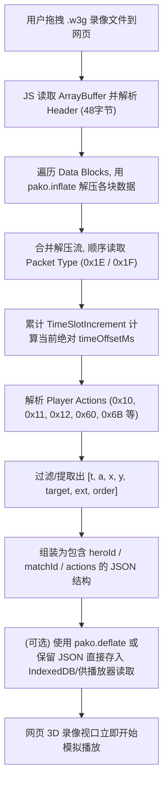

# 魔兽争霸3录像逆向分析与实现：播放逻辑、解锁8x限制、网页端模拟及w3g与dat转换

## 1. 结论摘要

1. **录像播放的本质机制（同步锁步执行引擎）：**
   - 魔兽争霸3录像（`.w3g`）**绝不是视频**，也不是逐帧位置快照，而是**离散指令流与同步时间戳（Lockstep Actions Stream）**。
   - 录像中仅记录了基础信息（地图路径/校验、玩家列表）和每个玩家在不同时间片（TimeSlot，通常以毫秒或 100ms 增量推进）内发出的玩家指令（Move 0x10/0x11、Attack/Target 0x12、Give Item 0x13、Drop 0x14、Subgroup 0x17、Select 0x16、Chat 0x60、GameCache Sync 0x6B 等）。
   - 游戏播放录像时，实际上是游戏引擎以特定伪随机数种子初始化地图与所有单位，随后像普通联机对局一样**完全在本地“重新运行一遍游戏”**。由录像流模拟网络封包向引擎喂入玩家动作。

2. **为什么默认最大只有 8x 速度？如何解锁（x64dbg / 补丁）？**
   - **UI限制机制**：UI 面板（`CReplayPanel`）的加速按钮（`ReplaySpeedUpIcon`）仅定义了 8 档速率预设（`1/4x`, `1/2x`, `1x`, `2x`, `4x`, `8x`），加速事件内部只允许索引在 `0 ~ 8` 范围推进，到达上限即禁用按钮。
   - **底层引擎限制机制**：游戏通过 `TimeScale` / 定时器时间步长（Tick Interval）控制录像重放速度。在 8x 速度时，每帧渲染间隙引擎循环执行 8 个游戏逻辑 Tick。若要在游戏内突破 8x（如 16x、32x 甚至无上限全速 Fast-Forward），可以通过 **x64dbg / 内存补丁直接修改 `TimeScale` 浮点倍率或 Hook Tick 步长**，或者 Hook `ReplaySpeedUp` 事件将倍率直接写入回放状态对象。

3. **可以在网页端模拟实现这种录像吗？**
   - **完全实现（100% 同步）：** 极难。需要将整个魔兽争霸3引擎（包括单位寻路、物理碰撞、单位攻击动画前后摇、AI决策、JASS脚本虚拟机以及 DotA 地图复杂的几万行 JASS 逻辑）全部在 JS/WASM 中重写。一旦有 1 个像素的寻路偏差或随机数不同步，几十秒后战局就会彻底蝴蝶效应崩盘。
   - **近似 3D 轨迹/动作还原（即项目已跑通的 War3Angular / Three.js 方案）：** **完全可行，且是当前最佳方案！** 前端加载单位 3D 模型（如剑圣 `HeroBladeMaster.mdx`、BLP贴图）和小地图，根据同步流中的移动坐标（0x11/0x12）、攻击动作、施法目标直接驱动模型播放 Run/Attack/Spell 动画并平滑位移。

4. **如果只有同步数据（`player_actions/*.dat`）可以实现录像吗？**
   - **完全可以驱动网页端 3D 录像视口回放！**
   - `War3Bot` 记录的 `.dat` 经逆向验证是经过 **Qt `qCompress` 压缩的 JSON**。解压后包含了 `gameStartMs`, `durationMs`, `heroId`, 以及按毫秒记录的动作矩阵 `[timeOffsetMs, actionId, x, y, targetId, extra, orderId]`。这些数据不仅包含了精确坐标 `(x, y)`，还包含了技能施法和聊天，网页端完全可以以此作为时间轴动画轨道（Timeline Track）直接驱动 3D 重放。

5. **如果我有录像文件（`.w3g`），可以转换为同步数据（`.dat`）吗？**
   - **完全可以！**
   - `.w3g` 是标准且公开的二进制格式（由 Header + 若干个 zlib 压缩块组成，包含 Block 0x1E/0x1F 的 TimeSlot 动作序列）。只需提取解压各 Block 内玩家的 Action 0x10~0x13、0x16~0x17、0x60、0x6B 等指令，转换为与 `War3Bot` 一致的 `[timeOffsetMs, actionId, x, y, targetId, extra, orderId]` 格式，再用 `qCompress` 打包为 `.dat` 文件，即可直接拖入网页端播放。

---

## 2. 魔兽争霸3录像（W3G）核心数据流与执行机制

### 2.1 W3G 录像文件二进制结构

```text
+------------------------------------------------------------+
| 0x00 - 0x2F: W3G Header (48 字节)                           |
|   "Warcraft III recorded game\x1A\0"                        |
|   HeaderSize(4), CompressedSize(4), HeaderVersion(4)        |
|   DecompressedSize(4), TotalBlocks(4), MagicIdent (WAR3/W3XP)|
|   VersionNumber(4), BuildNumber(2), Flags(2), LengthMS(4)  |
+------------------------------------------------------------+
| 0x30+: Compressed Data Blocks                              |
|   Block Header: CompressedBytes(2), DecompressedBytes(2), Checksum(4)
|   zlib Compressed Payload (通常每块 8192 字节解压为 8192 字节) |
+------------------------------------------------------------+
```

解压后的连续数据流被组织为一系列协议包（Replay Data Packets）：
1. **0x00**: 游戏设置与玩家列表初始化（PlayerRecord、GameSettings、MapPath、Host）。
2. **0x1E / 0x1F (TimeSlot / TimeSlotAck)**: 游戏时间片推进核心！
   - 结构：`0x1F | ByteCount(2) | TimeIncrement(2) | [PlayerActionData...]`
   - `TimeIncrement`：通常是 100ms（或 50ms/250ms），表示游戏逻辑推进的时长。
   - `PlayerActionData`：`PlayerId(1) | ActionLength(2) | Actions...`
3. **0x20**: Player Leaves Game（玩家退局）。
4. **0x22 / 0x23**: Checksum 同步检查点。

### 2.2 动作包（Actions）ID 与业务含义映射
录像中的 Action 字节与 War3 网络协议完全一致，正好与 `War3Bot/src/client.cpp` 中解析拦截的结构相同：

| ActionId | 含义 | 载荷长度与关键字段 |
|---|---|---|
| `0x10` | 无目标命令/技能（Stop, Hold, 技能开关） | `Flags(2) + AbilityId/OrderId(4) + Data(8)` |
| `0x11` | 点目标命令（移动、A地、点施法） | `Flags(2) + AbilityId(4) + Order(8) + X(4 float) + Y(4 float)` |
| `0x12` | 单位目标命令（攻击目标、指向性技能） | `Flags(2) + AbilityId(4) + Order(8) + X(4 float) + Y(4 float) + TargetUnitId(8)` |
| `0x13` | 物品/单位移交 | `... + ItemX(4) + ItemY(4) + TargetUnitId(8)` |
| `0x16` | 选择单位 / 框选 | `SelectMode(1) + UnitCount(2) + [UnitId(8)...]` |
| `0x17` | 编队设置 / 增加 | `GroupIndex(1) + UnitCount(2) + [UnitId(8)...]` |
| `0x60` | 玩家聊天 | `TriggerHandle(4) + EventHandle(4) + ChatText\0` |
| `0x6B` | DotA 同步缓存（GameCache） | `CacheName\0 + MissionKey\0 + Key\0 + Value(4)` |

---

## 3. 逆向深入：Game.dll 录像加速机制与全版本函数偏移

### 3.1 8x 限制的逆向发现与实现原理
通过对 `game.dll` 的静态逆向（基于 UI 字符串 `ReplaySpeedUpIcon`、`ReplaySpeedMultiplier` 与 `CReplayPanel.cpp`）：
1. **UI 事件分发入口**：
   - 录像控制台是一个 `CReplayPanel` 实例。
   - 点击面板按钮时触发事件 `0xE0064 ~ 0xE006C`。
   - 在各版本的事件 Switch 分发中：
     - `Case 6`（事件 `0xE006A`）为 **SpeedUp（加速）**。
     - `Case 8`（事件 `0xE006C`）为 **SpeedDown（减速）**。
2. **档位与速率**：
   - 游戏内部预置了 8 个离散档位：`[1/4x, 1/2x, 1x, 2x, 4x, 8x]`（部分版本内部留有 `1/8x` 和 `16x` 的 slot 但未开放）。
   - 在 SpeedUp 函数内部，游戏取当前速率索引：若当前索引等于最大允许索引（8x 档位），则直接禁止推进并置灰 `ReplaySpeedUpIcon`。
3. **引擎的播放速率控制（TimeScale 与 Lockstep Tick）**：
   - War3 的游戏循环在每帧调用 `CGameWar::Step(deltaTime * timeScale)`。
   - 录像模式下，游戏不受网络延迟等待（Net Waiting）影响，引擎在每一帧中只要录像流中还有数据，就连续调用指定次数的 Tick 处理。
   - 限制在 8x 的原因主要是暴雪为了防止单核 CPU 在解析复杂技能特效和寻路时发生严重掉帧卡死。

### 3.2 各版本（1.0.17 ~ 1.27.0）Game.dll 核心函数偏移表

在 `D:\Qt\workspace\War3Launcher\versions` 下全部 11 个版本 `Game.dll` 的逆向定位结果如下：

> 注：ImageBase 统一为 `0x6F000000`。RVA = VA - `0x6F000000`。
> 对于 1.27.0.52240，`.text` 节文件偏移比 RVA 少 `0xC00`；其他版本 RVA 与文件偏移一致。

| Warcraft III 版本 | 事件 Switch RVA | 跳转表 Table VA | SpeedUp 函数 RVA | SpeedDown 函数 RVA | 全局回放指针 VA |
|---|---|---|---|---|---|
| **1.0.17.5988** | `0x1505D3` | `0x6F150704` | `0x150400` | `0x1504A0` | `0x6F87125C` |
| **1.0.20.6048** | `0x1505D3` | `0x6F150704` | `0x150400` | `0x1504A0` | `0x6F87229C` |
| **1.20.4.6074** | `0x1505E3` | `0x6F150714` | `0x150410` | `0x1504B0` | `0x6F8722BC` |
| **1.21.0.6263** | `0x150643` | `0x6F150774` | `0x150470` | `0x150510` | `0x6F873334` |
| **1.22.0.6328** | `0x3636D0` | `0x6F3637F4` | `0x363610` | `0x3582F0` | `0x6FAA2FFC` |
| **1.23.0.6352** | `0x364C50` | `0x6F364D74` | `0x364B90` | `0x359870` | `0x6FABBE4C` |
| **1.24.1.6374** | `0x364D10` | `0x6F364E34` | `0x364C50` | `0x359930` | `0x6FACD44C` |
| **1.24.4.6387** | `0x364DD0` | `0x6F364EF4` | `0x364D10` | `0x3599F0` | `0x6FACD44C` |
| **1.25.1.6397** | `0x364060` | `0x6F364184` | `0x363FA0` | `0x358C80` | `0x6FAB65F4` |
| **1.26.0.6401** | `0x364290` | `0x6F3643B4` | `0x3641D0` | `0x358EB0` | `0x6FAB65F4` |
| **1.27.0.52240** | `0x3A0683` | `0x6F3A07AC` | `0x3A7300` | `0x3A73B0` | `0x6FBE4238` |

### 3.3 如何解锁最大 8x 速度（x64dbg 操作指南）

在 x64dbg 中有两种解锁策略：

#### 方案 A：直接修改底层游戏速率（TimeScale 浮点值 / 推荐验证法）
1. 用 x64dbg 附加或启动 `war3.exe`，加载任意录像播放。
2. 录像正常播放时，游戏全局时钟会引用 `SetGameSpeed` / `TimeScale`。
3. 在 1.26 中，读取 `[0x6FAB65F4]`（全局回放指针 `pReplay`），其二级偏移 `pReplay + 0x34` 即为回放核心上下文 `pReplayContext`。
4. 在 x64dbg 内存窗口或硬件写入断点跟踪该结构体，直接修改其 `TickSpeed` 或倍率（例如将当前 8x 对应的倍率改成 16.0f 或 32.0f）。
5. 画面即可立即以 16x / 32x 飞速快进。

#### 方案 B：解除 SpeedUp 档位上限（UI/按钮补丁法）
1. 在 1.26 的 `0x6F3641D0`（SpeedUp 函数）：
   - 函数检查上界时使用的是 `cmp eax, 5` 或类似档位比较。
   - 使用 x64dbg 将上限校验 nop 掉，或者修改跳转逻辑。
   - 同时将计算倍率的移位指令 `shl edx, cl` 允许推进到更大的数值。

---

## 4. 网页端模拟播放可行性分析

### 4.1 两种模拟实现模式对比

| 维度 | 模式 A：像素级 100% 引擎模拟 | 模式 B：轨迹与动作 3D 还原（推荐现行方案） |
|---|---|---|
| **原理** | 将整个 War3 逻辑编译/翻译为 WASM（包括全部单位数据、弹道、JASS虚拟机） | 利用动作流中的 `(x, y)` 坐标、目标、动画状态驱动 Three.js / WebGL 渲染 |
| **可行性** | **极低**。War3 闭源，JASS+DotA 机制庞大，任一点微小浮点/同步分歧会导致战局脱轨 | **极高**。已有 War3Angular 和 Three.js / `mdx-m3-viewer` 现成基础 |
| **是否依赖地图计算** | 必须执行地图完整脚本 | **不需要**。直接消费录像/数据包中已发生的动作事实 |
| **适用场景** | 完美克隆游戏客户端（成本极高） | **网页 3D 录像复盘、战局追踪、反作弊轨迹审查、外挂检测** |

### 4.2 为什么只有同步数据就能在网页端播放？

经过对 `wuxiancong` 目录下的 `.dat` 结构逆向：
- `.dat` 文件本质是 Qt `qCompress` 压缩后的标准 JSON 数据。
- 解压后包含：
  - `heroId`: 英雄类型代码（如 `0x45776172`，即剑圣等）。
  - `matchId`, `player`, `durationMs`: 对局信息。
  - `actions`: `[[timeOffsetMs, actionId, x, y, targetId, extra, orderId], ...]`。
- 关键点在于：**玩家所有位移（0x11）、攻击（0x12）、回城/跳刀（0x10/0x12 + OrderId）都带有绝对坐标 `(x, y)` 和目标 ID**！
- **网页端播放器运行逻辑**：
  1. 创建时间轴（0 ~ `durationMs`）。
  2. 根据 `heroId` 实例化对应模型的 3D Mesh（使用现有的 `HeroBladeMaster.mdxbin` 与 BLP 材质）。
  3. 随着时间轴推进，当到达 `timeOffsetMs` 时：
     - 若为 `actionId == 0x11`（Move/Patrol）：将英雄目标位置设为 `(x, y)`，模型切换为 `Walk` 序列，并在两点间进行位置插值与朝向旋转计算。
     - 若为 `actionId == 0x12`（Attack/Cast）：模型朝向 `(x, y)` 并播放 `Attack` 动画。
     - 若为 `actionId == 0x60`：在屏幕侧边弹出该玩家的聊天弹幕。
     - 若为 `actionId == 0x6B`：更新小地图上的神符、技能状态或比分数据。

---

## 5. 录像文件（.w3g）转同步数据（.dat）的可行性与转换算法

### 5.1 转换可行性：100% 可行
- `.w3g` 中的动作包（`0x10 ~ 0x13`, `0x60`, `0x6B`）结构与 `War3Bot` 记录的 `ActionRecord` 是 **同源同构** 的。
- `War3Bot` 本身就是从网络中直接解出的这些包；而 `.w3g` 只是把这些网络包按时间片（Block 0x1E/0x1F）压缩在文件中而已。

### 5.2 网页端“拖入 .w3g 自动转换为 .dat”的完整处理流程



### 5.3 转换核心实现逻辑（JavaScript / TypeScript 伪代码）

```javascript
// 在网页前端利用 JavaScript / pako 即可在本地无缝完成转换
async function convertW3gToDatJson(w3gArrayBuffer) {
    const reader = new DataView(w3gArrayBuffer);
    // 1. 校验 Header "Warcraft III recorded game"
    // 2. 解压所有的 8KB Block
    let uncompressedData = decompressBlocks(reader);
    
    let offset = 0;
    let timeOffsetMs = 0;
    const records = [];
    
    while (offset < uncompressedData.length) {
        const type = uncompressedData[offset++];
        if (type === 0x1E || type === 0x1F) {
            const byteCount = readUInt16(uncompressedData, offset); offset += 2;
            const timeInc = readUInt16(uncompressedData, offset); offset += 2;
            timeOffsetMs += timeInc;
            
            const blockEnd = offset + byteCount - 2;
            while (offset < blockEnd) {
                const pid = uncompressedData[offset++];
                const actionLen = readUInt16(uncompressedData, offset); offset += 2;
                const nextAction = offset + actionLen;
                
                while (offset < nextAction) {
                    const actionId = uncompressedData[offset++];
                    let x = 0, y = 0, targetId = 0, orderId = 0, extra = "";
                    
                    if (actionId === 0x11) { // 点移动
                        offset += 6; // flags(2) + ability(4)
                        orderId = readUInt32(uncompressedData, offset); offset += 8;
                        x = readFloat32(uncompressedData, offset); offset += 4;
                        y = readFloat32(uncompressedData, offset); offset += 4;
                    } else if (actionId === 0x12) { // 目标/攻击
                        offset += 6;
                        orderId = readUInt32(uncompressedData, offset); offset += 8;
                        x = readFloat32(uncompressedData, offset); offset += 4;
                        y = readFloat32(uncompressedData, offset); offset += 4;
                        targetId = readUInt32(uncompressedData, offset); offset += 8;
                    } else if (actionId === 0x60) { // 聊天
                        offset += 8; // handles
                        extra = readNullTerminatedString(uncompressedData, offset);
                        offset += extra.length + 1;
                    } else if (actionId === 0x6B) { // GameCache同步
                        // 读取 MissionKey / Key / Value
                    } else {
                        // 根据固定长度跳过其他 actionId
                        offset = skipActionPayload(actionId, offset);
                    }
                    records.push([timeOffsetMs, actionId, x, y, targetId, extra, orderId]);
                }
            }
        }
    }
    
    return {
        matchId: "reconstructed_from_w3g",
        durationMs: timeOffsetMs,
        format: "t,a,x,y,target,ext,order",
        actions: records
    };
}
```

---

## 6. 总结与建议行动项

1. **录像本质**：魔兽3录像仅是包含时间戳的玩家输入流，完全依赖引擎确定性重跑；网页端不需要、也不应该尝试复刻整个 JASS 虚拟机，而应专注于**提取输入坐标与目标序列做 3D 轨迹重放**。
2. **解除 8x 速度**：核心阻碍是 UI 层上限比较和引擎 Tick 循环系数；在 1.26 中可直接根据 RVA `0x3641D0`（SpeedUp 函数）定位并解除限制。
3. **网页拖拽转换落地**：在现有的 `War3Angular` 3D 录像视口中，增加一个简单的 HTML5 文件拖拽区域。当用户将 `.w3g` 拖入时，纯前端用 JS 解包 Block 0x1F，生成与现行 `.dat` 相同的 JSON 轨迹结构，无需经过任何服务器上传，直接在客户端启动 3D 轨迹播放。

